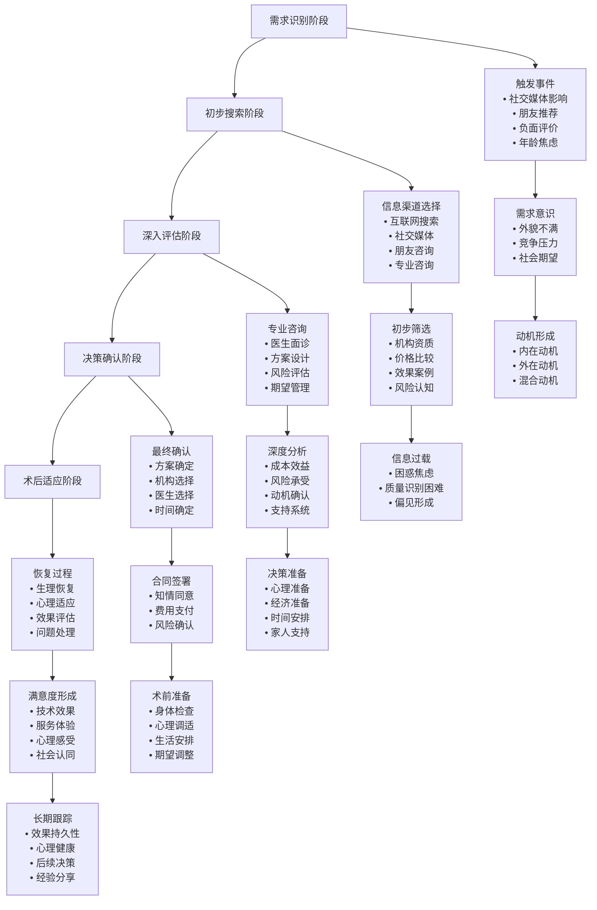
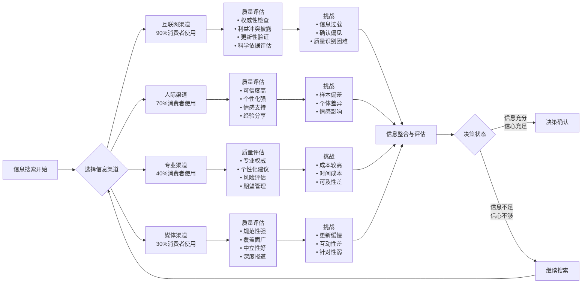
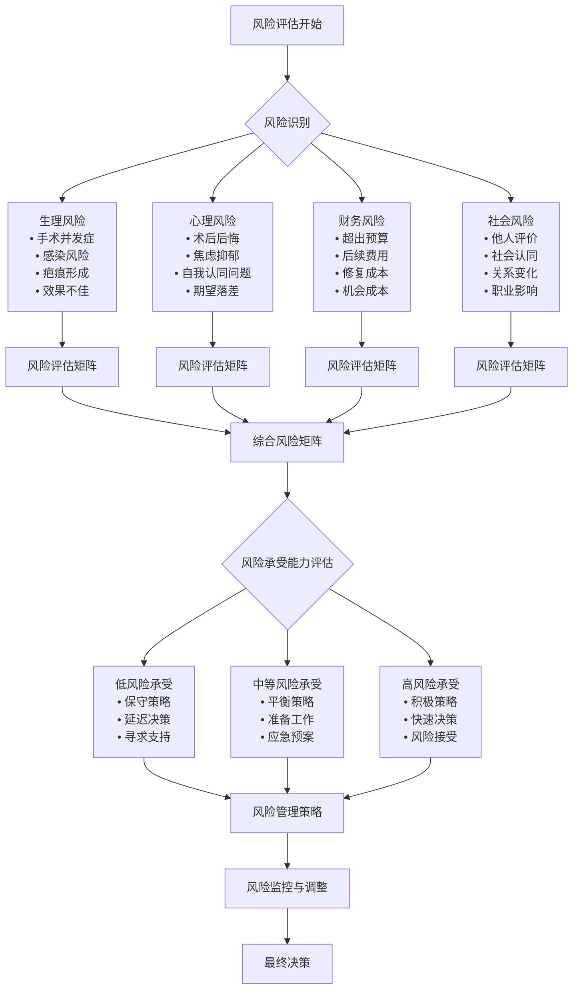
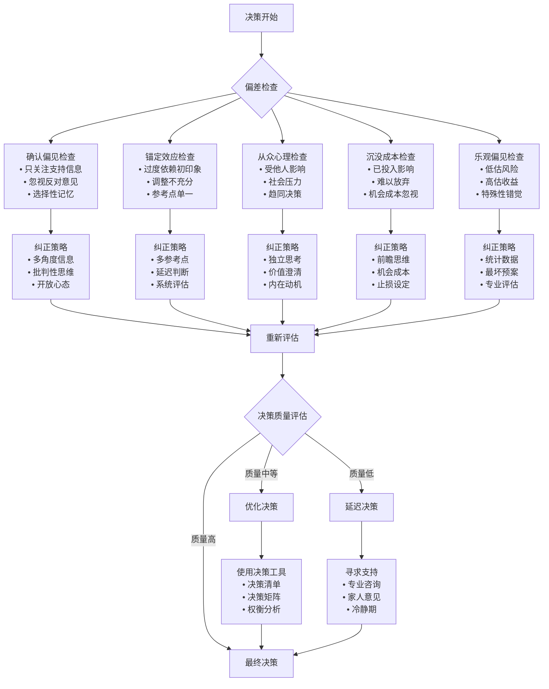

# Consumer Decision Journey Flowcharts

## 1. Complete Consumer Decision Process

## 2. Information Search Behavior Patterns

## 3. Risk Assessment Workflow

## 4. Decision Bias Correction Process

