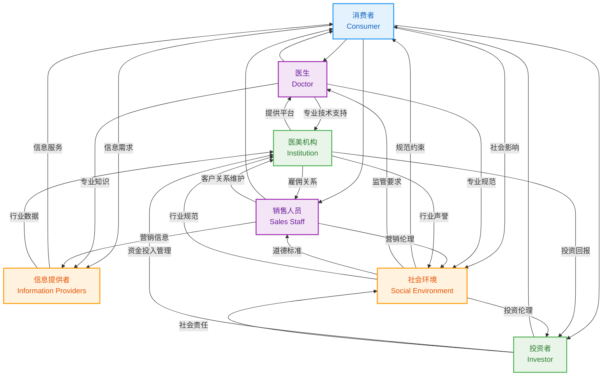
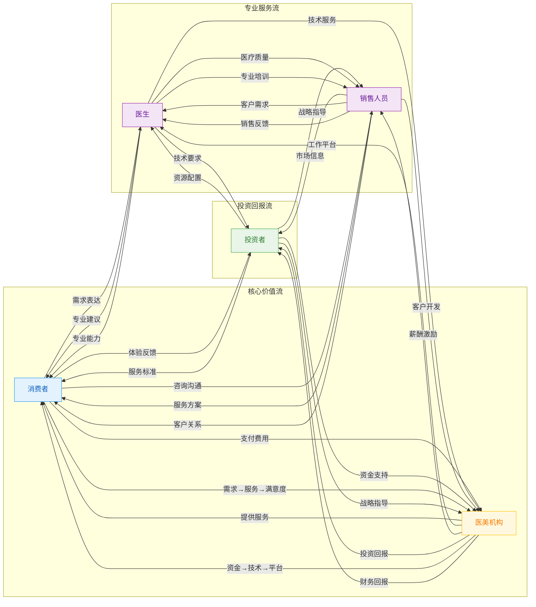
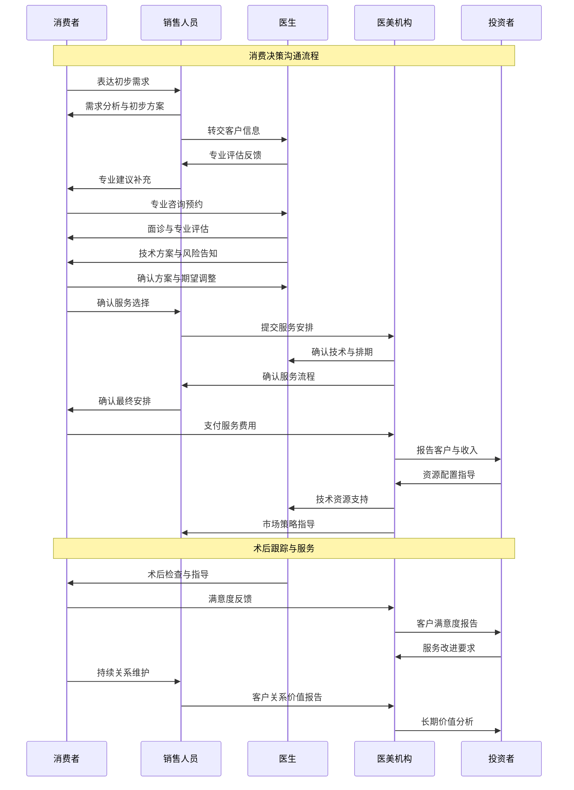
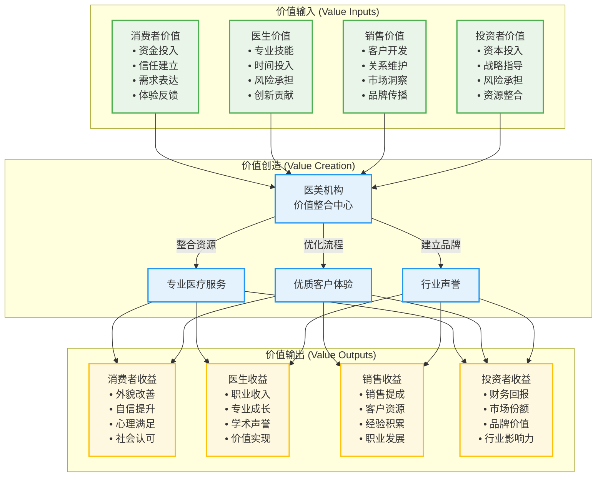

# Stakeholder Relationship Maps & Ecosystem Diagrams

## 1. Multi-Party Ecosystem Framework

## 2. Role Interaction Network

## 3. Communication Flow Patterns

## 4. Value Exchange Network

## 5. Decision-Making Influence Network

```mermaid
graph TD
    subgraph "个人影响因素 (Personal Factors)"
        Age[年龄因素]
        Gender[性别差异]
        Income[收入水平]
        Education[教育背景]
        Personality[人格特质]
        Experience[过往经验]
    end

    subgraph "社会影响因素 (Social Factors)"
        Family[家庭影响]
        Friends[朋友意见]
        Colleagues[同事观点]
        Social_Media[社交媒体]
        Culture[文化背景]
        Trends[流行趋势]
    end

    subgraph "专业影响因素 (Professional Factors)"
        Doctor_Quality[医生专业度]
        Institution_Reputation[机构声誉]
        Technology_Level[技术水平]
        Price[价格因素]
        Service_Quality[服务质量]
        Risk_Communication[风险沟通]
    end

    subgraph "心理影响因素 (Psychological Factors)"
        Anxiety[外貌焦虑]
        Motivation[动机类型]
        Risk_Perception[风险感知]
        Self_Concept[自我概念]
        Body_Image[身体意象]
        Decision_Style[决策风格]
    end

    subgraph "决策结果 (Decision Outcomes)"
        Decision_Quality[决策质量]
        Satisfaction[满意度]
        Regret[后悔程度]
        Future_Intention[未来意向]
        Word_of_Mouth[口碑传播]
    end

    Age --> Decision_Quality
    Gender --> Decision_Quality
    Income --> Decision_Quality
    Education --> Decision_Quality
    Personality --> Decision_Quality
    Experience --> Decision_Quality

    Family --> Motivation
    Friends --> Motivation
    Colleagues --> Motivation
    Social_Media --> Anxiety
    Culture --> Body_Image
    Trends --> Motivation

    Doctor_Quality --> Risk_Perception
    Institution_Reputation --> Decision_Quality
    Technology_Level --> Risk_Perception
    Price --> Decision_Quality
    Service_Quality --> Satisfaction
    Risk_Communication --> Regret

    Anxiety --> Decision_Style
    Motivation --> Decision_Quality
    Risk_Perception --> Decision_Quality
    Self_Concept --> Motivation
    Body_Image --> Motivation
    Decision_Style --> Decision_Quality

    Decision_Quality --> Satisfaction
    Satisfaction --> Future_Intention
    Satisfaction --> Word_of_Mouth
    Regret --> Future_Intention

    classDef personalStyle fill:#E3F2FD,stroke:#2196F3
    classDef socialStyle fill:#F3E5F5,stroke:#9C27B0
    classDef professionalStyle fill:#E8F5E8,stroke:#4CAF50
    classDef psychologicalStyle fill:#FFF3E0,stroke:#FF9800
    classDef outcomeStyle fill:#FFEBEE,stroke:#F44336

    class Age,Gender,Income,Education,Personality,Experience personalStyle
    class Family,Friends,Colleagues,Social_Media,Culture,Trends socialStyle
    class Doctor_Quality,Institution_Reputation,Technology_Level,Price,Service_Quality,Risk_Communication professionalStyle
    class Anxiety,Motivation,Risk_Perception,Self_Concept,Body_Image,Decision_Style psychologicalStyle
    class Decision_Quality,Satisfaction,Regret,Future_Intention,Word_of_Mouth outcomeStyle
```

