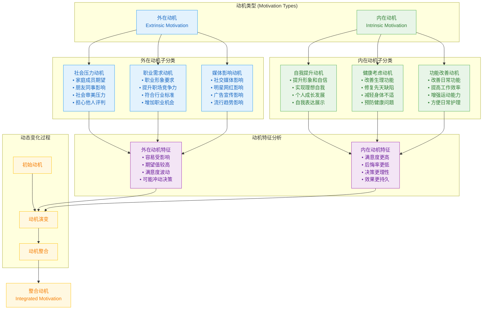
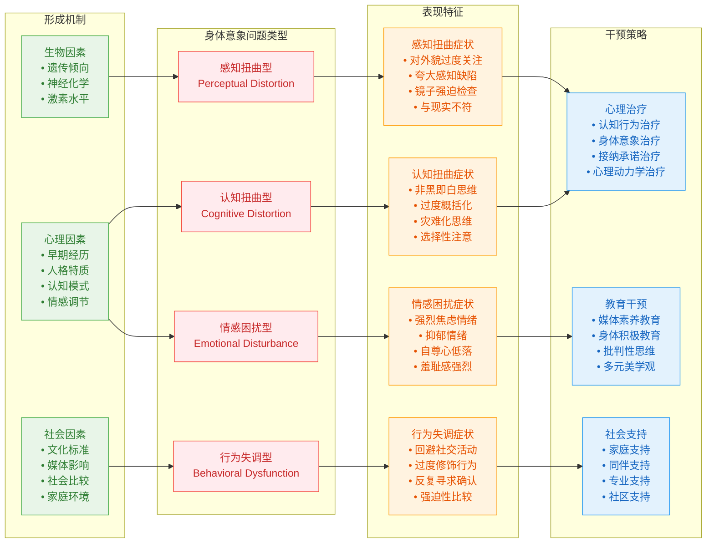
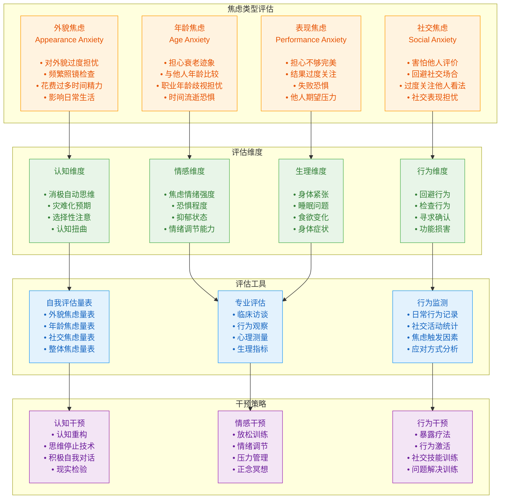
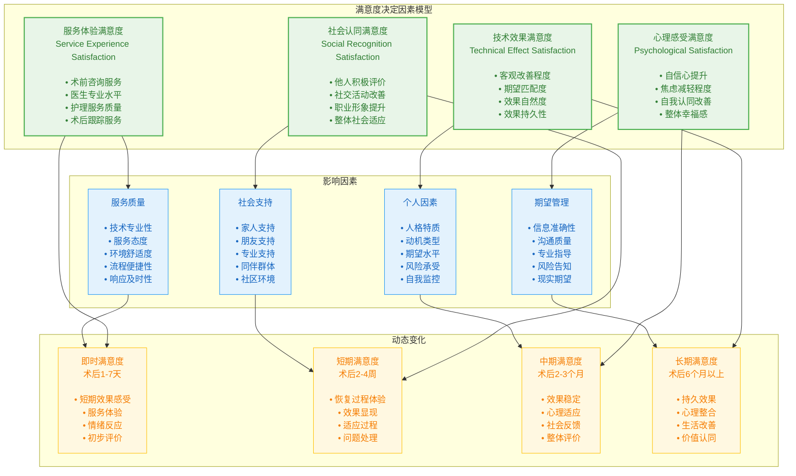

# Psychological Theory Framework Visualizations

## 1. Motivation Type Classification Framework



## 2. Body Image Disorder Framework



## 3. Maslow's Hierarchy Applied to Medical Aesthetics

```mermaid
graph TD
    subgraph "马斯洛需求层次在医美中的应用"

        Level1[生理需求<br>Physiological Needs<br><br>• 修复先天缺陷<br>• 改善呼吸功能<br>• 消除身体疼痛<br>• 恢复正常功能]

        Level2[安全需求<br>Safety Needs<br><br>• 预防健康风险<br>• 增强身体安全感<br>• 减少医疗风险<br>• 保障长期健康]

        Level3[社交需求<br>Social Needs<br><br>• 获得群体接纳<br>• 改善人际关系<br>• 增强社交自信<br>• 融入社会环境]

        Level4[尊重需求<br>Esteem Needs<br><br>• 提升自我价值感<br>• 获得他人尊重<br>• 增强职业形象<br>• 建立社会地位]

        Level5[自我实现需求<br>Self-Actualization<br><br>• 实现理想形象<br>• 表达个性特征<br>• 追求完美境界<br>• 达成人生目标]

    end

    subgraph "不同收入群体的需求重点"

        Low_Income[低收入群体<br><br>• 主要关注基础需求<br>• 功能修复优先<br>• 健康安全考虑<br>• 性价比导向]

        Middle_Income[中等收入群体<br><br>• 平衡多层次需求<br>• 社交与尊重并重<br>• 职业发展考虑<br>• 生活品质提升]

        High_Income[高收入群体<br><br>• 重视高层次需求<br>• 自我实现导向<br>• 个性表达重视<br>• 完美追求强烈]

    end

    subgraph "年龄群体需求差异"

        Young_Group[年轻群体(20-30岁)<br><br>• 社交需求强烈<br>• 时尚追求<br>• 个性表达<br>• 社会认同]

        Middle_Group[中年群体(30-45岁)<br><br>• 尊重需求突出<br>• 职业竞争力<br>• 年龄焦虑应对<br>• 社会地位维护]

        Senior_Group[年长群体(45岁以上)<br><br>• 安全需求增加<br>• 健康功能优先<br>• 生活质量提升<br>• 自然老化接受]

    end

    Level1 --> Level2
    Level2 --> Level3
    Level3 --> Level4
    Level4 --> Level5

    Level1 --> Low_Income
    Level3 --> Middle_Income
    Level5 --> High_Income

    Level3 --> Young_Group
    Level4 --> Middle_Group
    Level2 --> Senior_Group

    classDef hierarchyStyle fill:#E3F2FD,stroke:#2196F3,color:#1565C0,stroke-width:3px
    classDef incomeStyle fill:#F3E5F5,stroke:#9C27B0,color:#6A1B9A
    classDef ageStyle fill:#E8F5E8,stroke:#4CAF50,color:#2E7D32

    class Level1,Level2,Level3,Level4,Level5 hierarchyStyle
    class Low_Income,Middle_Income,High_Income incomeStyle
    class Young_Group,Middle_Group,Senior_Group ageStyle
```

## 4. Anxiety Assessment Model



## 5. Satisfaction Determination Factors

