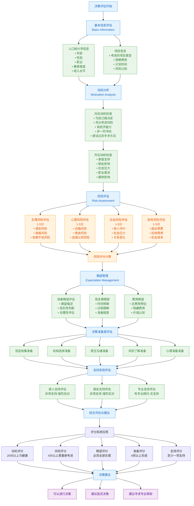
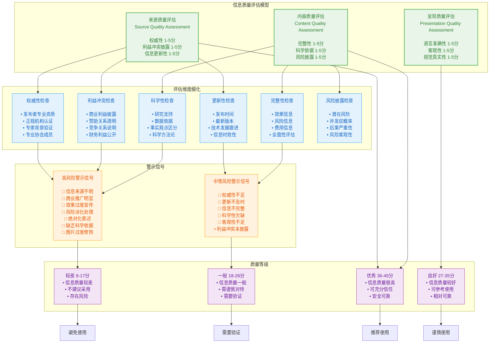
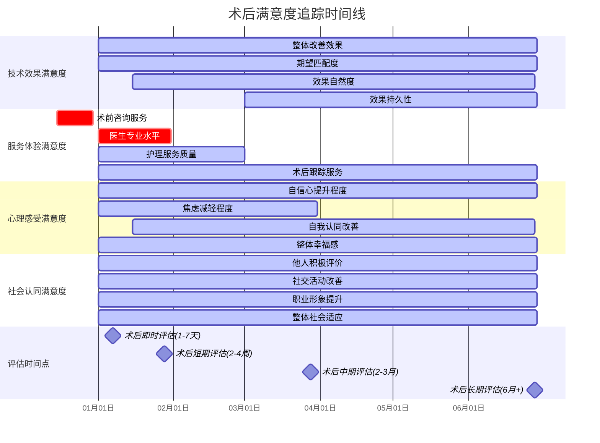
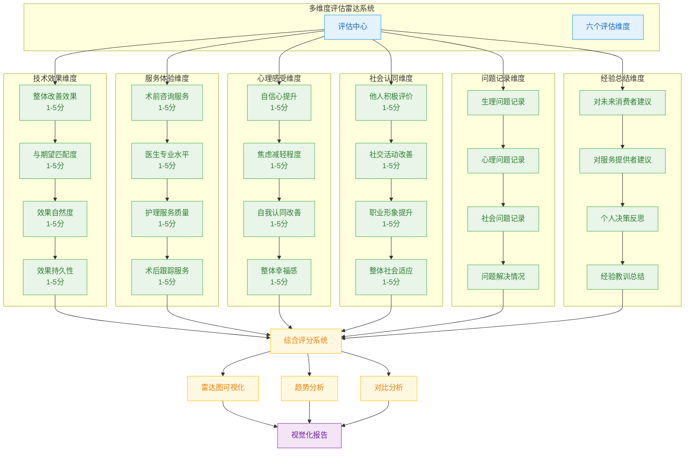
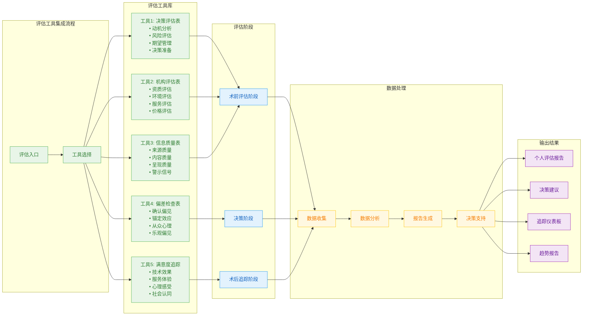

# Assessment Tools Process Diagrams & Tracking Charts

## 1. Medical Aesthetics Decision Assessment Process

## 2. Information Quality Assessment Framework

## 3. Post-Operation Satisfaction Tracking Timeline

## 4. Multi-Dimensional Assessment Radar System

## 5. Assessment Tool Integration Workflow

