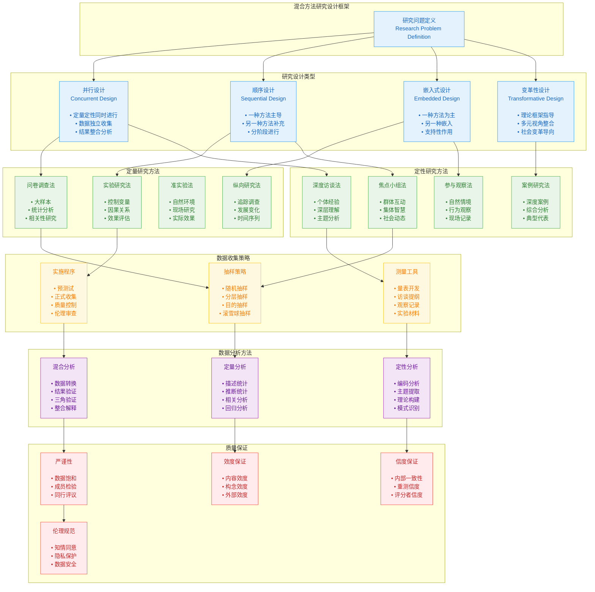
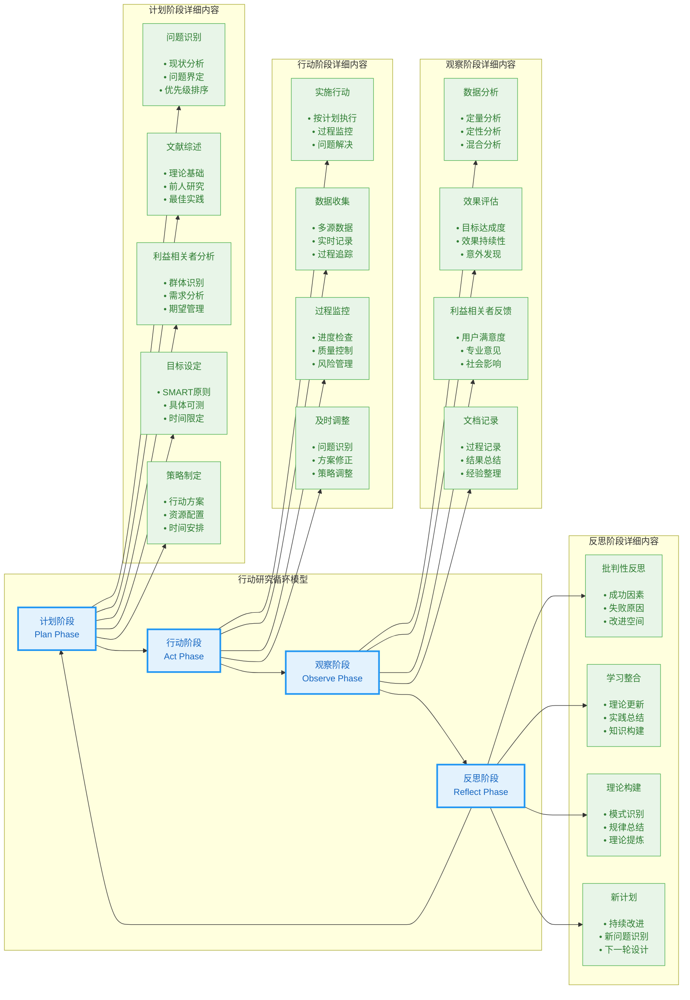
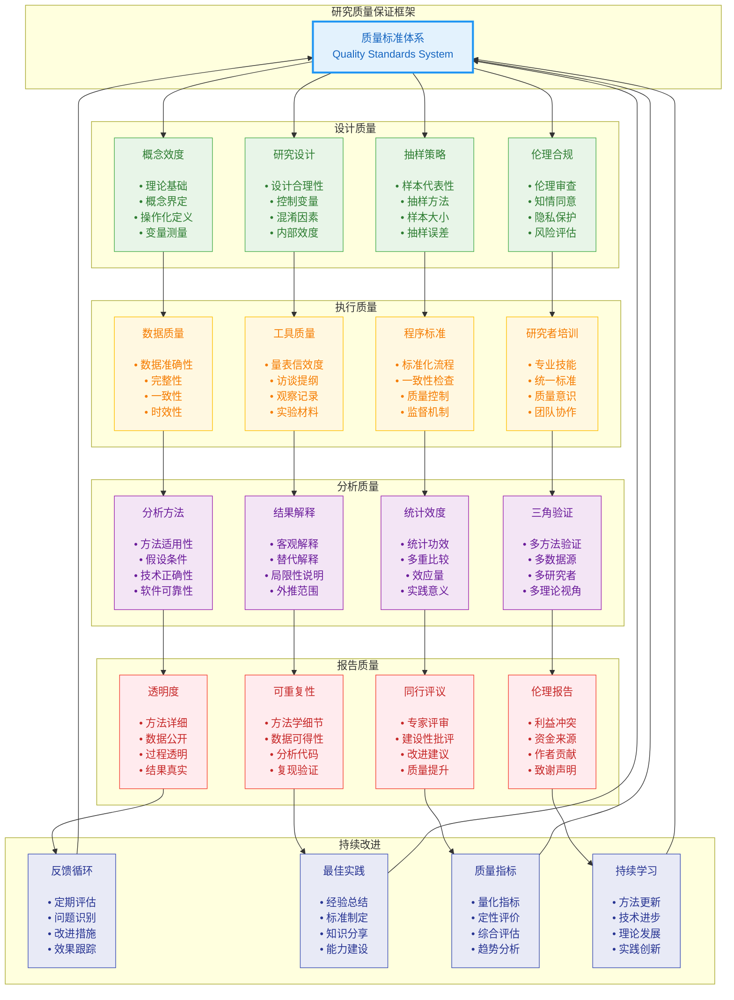

# Research Methodology Visualizations

## 1. Mixed Methods Research Design Framework

## 2. Action Research Process Framework

## 3. Data Analysis Workflow Pipeline

```mermaid
graph TD
    subgraph "数据分析工作流"

        DataEntry[数据入口<br>Data Entry]

    end

    subgraph "数据预处理"

        DataCleaning[数据清洗<br><br>• 缺失值处理<br>• 异常值检测<br>• 数据标准化<br>• 格式统一]

        DataIntegration[数据整合<br><br>• 多源数据合并<br>• 时间对齐<br>• 变量匹配<br>• 数据关联]

        DataTransformation[数据转换<br><br>• 变量计算<br>• 分类编码<br>• 指标构建<br>• 数据重构]

    end

    subgraph "定量数据分析"

        DescriptiveStats[描述性统计<br><br>• 集中趋势<br>• 离散程度<br>• 分布特征<br>• 可视化展示]

        InferentialStats[推断性统计<br><br>• 假设检验<br>• 参数估计<br>• 效应量计算<br>• 置信区间]

        CorrelationAnalysis[相关分析<br><br>• 皮尔逊相关<br>• 斯皮尔曼相关<br>• 偏相关分析<br>• 相关矩阵]

        RegressionAnalysis[回归分析<br><br>• 线性回归<br>• 逻辑回归<br>• 多元回归<br>• 模型验证]

    end

    subgraph "定性数据分析"

        Coding[编码分析<br><br>• 开放式编码<br>• 主轴编码<br>• 选择性编码<br>• 编码手册]

        ThemeAnalysis[主题分析<br><br>• 主题识别<br>• 主题分类<br>• 主题关系<br>• 主题网络]

        PatternRecognition[模式识别<br><br>• 行为模式<br>• 语言模式<br>• 思维模式<br>• 交互模式]

        TheoryBuilding[理论构建<br><br>• 概念定义<br>• 命题形成<br>• 理论框架<br>• 模型构建]

    end

    subgraph "混合方法分析"

        DataTransformation[数据转换<br><br>• 定性→定量<br>• 定量→定性<br>• 并行分析<br>• 顺序分析]

        Triangulation[三角验证<br><br>• 数据三角<br>• 方法三角<br>• 理论三角<br>• 研究者三角]

        Integration[结果整合<br><br>• 比较分析<br>• 互补验证<br>• 扩展解释<br>• 综合结论]

        MetaInference[元推理<br><br>• 整体理解<br>• 深层洞察<br>• 理论贡献<br>• 实践意义]

    end

    subgraph "质量验证"

        ReliabilityCheck[信度检验<br><br>• 内部一致性<br>• 重测信度<br>• 评分者信度<br>• 分半信度]

        ValidityCheck[效度检验<br><br>• 内容效度<br>• 构念效度<br>• 效标效度<br>• 区分效度]

        RobustnessCheck[稳健性检验<br><br>• 敏感性分析<br>• 替代方法<br>• 子样本分析<br>• 异质性检验]

        PeerReview[同行评议<br><br>• 专家评审<br>• 方法讨论<br>• 结果质疑<br>• 改进建议]

    end

    subgraph "结果输出"

        StatisticalReport[统计分析报告<br><br>• 结果表格<br>• 统计图表<br>• 假设检验结果<br>• 效应量报告]

        QualitativeReport[定性分析报告<br><br>• 主题描述<br>• 典型引述<br>• 模式解释<br>• 理论阐述]

        IntegratedReport[整合研究报告<br><br>• 混合方法结果<br>• 整合解释<br>• 理论贡献<br>• 实践启示]

        Visualization[可视化展示<br><br>• 交互图表<br>• 多维展示<br>• 动态演示<br>• 仪表板]

    end

    DataEntry --> DataCleaning
    DataCleaning --> DataIntegration
    DataIntegration --> DataTransformation

    DataTransformation --> DescriptiveStats
    DataTransformation --> Coding

    DescriptiveStats --> InferentialStats
    InferentialStats --> CorrelationAnalysis
    CorrelationAnalysis --> RegressionAnalysis

    Coding --> ThemeAnalysis
    ThemeAnalysis --> PatternRecognition
    PatternRecognition --> TheoryBuilding

    RegressionAnalysis --> DataTransformation_Mixed
    TheoryBuilding --> DataTransformation_Mixed

    DataTransformation_Mixed --> Triangulation
    Triangulation --> Integration
    Integration --> MetaInference

    MetaInference --> ReliabilityCheck
    ReliabilityCheck --> ValidityCheck
    ValidityCheck --> RobustnessCheck
    RobustnessCheck --> PeerReview

    PeerReview --> StatisticalReport
    PeerReview --> QualitativeReport
    PeerReview --> IntegratedReport
    IntegratedReport --> Visualization

    classDef workflowStyle fill:#E3F2FD,stroke:#2196F3,color:#1565C0
    classDef preprocessStyle fill:#E8F5E8,stroke:#4CAF50,color:#2E7D32
    classDef analysisStyle fill:#FFF8E1,stroke:#FFC107,color:#F57C00
    classDef qualityStyle fill:#F3E5F5,stroke:#9C27B0,color:#6A1B9A
    classDef outputStyle fill:#FFEBEE,stroke:#F44336,color:#C62828

    class DataEntry workflowStyle
    class DataCleaning,DataIntegration,DataTransformation preprocessStyle
    class DescriptiveStats,InferentialStats,CorrelationAnalysis,RegressionAnalysis,Coding,ThemeAnalysis,PatternRecognition,TheoryBuilding,DataTransformation_Mixed,Triangulation,Integration,MetaInference analysisStyle
    class ReliabilityCheck,ValidityCheck,RobustnessCheck,PeerReview qualityStyle
    class StatisticalReport,QualitativeReport,IntegratedReport,Visualization outputStyle
```

## 4. Research Quality Assurance Framework

