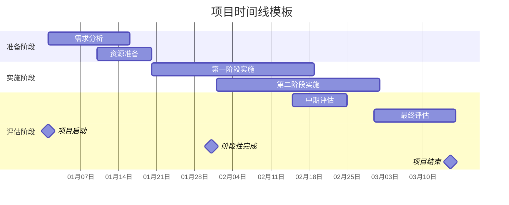

# Mermaid Template System with Consistent Styling

## 1. Global Style Variables

```css
/* Medical Aesthetics Psychology - Mermaid Style Variables */
:root {
  /* Primary Colors */
  --primary-blue: #2E86AB;
  --primary-blue-light: #E3F2FD;
  --primary-blue-dark: #1565C0;

  /* Secondary Colors */
  --secondary-purple: #A23B72;
  --secondary-purple-light: #F3E5F5;
  --secondary-purple-dark: #6A1B9A;

  /* Accent Colors */
  --accent-green: #8FD14F;
  --accent-green-light: #E8F5E8;
  --accent-green-dark: #2E7D32;

  --warning-orange: #F18F01;
  --warning-orange-light: #FFF3E0;
  --warning-orange-dark: #E65100;

  /* Neutral Colors */
  --neutral-gray: #4A4A4A;
  --neutral-gray-light: #F5F5F5;
  --neutral-gray-dark: #212121;

  /* Status Colors */
  --success-green: #4CAF50;
  --warning-yellow: #FFC107;
  --error-red: #F44336;
  --info-blue: #2196F3;

  /* Typography */
  --font-family: 'Segoe UI', Tahoma, Geneva, Verdana, sans-serif;
  --font-size-base: 12px;
  --font-size-large: 14px;
  --font-size-small: 10px;

  /* Spacing */
  --spacing-xs: 2px;
  --spacing-sm: 4px;
  --spacing-md: 8px;
  --spacing-lg: 12px;
  --spacing-xl: 16px;

  /* Border Radius */
  --border-radius-sm: 3px;
  --border-radius-md: 6px;
  --border-radius-lg: 8px;
}
```

## 2. Flowchart Template

```mermaid
%% Template: Medical Aesthetics Psychology Flowchart
%% Usage: Standardized flowchart for processes and workflows
%% Style: Consistent with book design guidelines

flowchart TD
    %% Define styles
    classDef processNode fill:var(--primary-blue-light),stroke:var(--primary-blue),stroke-width:2px,color:var(--primary-blue-dark),font-family:var(--font-family),font-size:var(--font-size-base)
    classDef decisionNode fill:var(--warning-orange-light),stroke:var(--warning-orange),stroke-width:2px,color:var(--warning-orange-dark),font-family:var(--font-family),font-size:var(--font-size-base)
    classDef startEndNode fill:var(--accent-green-light),stroke:var(--accent-green),stroke-width:2px,color:var(--accent-green-dark),font-family:var(--font-family),font-size:var(--font-size-base)
    classDef subProcessNode fill:var(--secondary-purple-light),stroke:var(--secondary-purple),stroke-width:2px,color:var(--secondary-purple-dark),font-family:var(--font-family),font-size:var(--font-size-base)

    %% Template nodes (replace with actual content)
    Start[开始]:::startEndNode --> Process1[处理步骤1]:::processNode
    Process1 --> Decision{决策点}:::decisionNode
    Decision -->|"选项A"| Process2A[处理2A]:::subProcessNode
    Decision -->|"选项B"| Process2B[处理2B]:::subProcessNode
    Process2A --> End[结束]:::startEndNode
    Process2B --> End

    %% Subgraph template
    subgraph SubProcess [子流程名称]
        Sub1[子步骤1]:::processNode
        Sub2[子步骤2]:::processNode
    end

    %% Styling for links
    linkStyle default stroke:var(--neutral-gray),stroke-width:1px,fill:none
```

## 3. Stakeholder Map Template

```mermaid
%% Template: Stakeholder Relationship Map
%% Usage: Visualizing relationships between stakeholders
%% Style: Clean, professional layout

graph TD
    %% Define styles
    classDef consumerNode fill:var(--primary-blue-light),stroke:var(--primary-blue),stroke-width:2px,color:var(--primary-blue-dark)
    classDef professionalNode fill:var(--secondary-purple-light),stroke:var(--secondary-purple),stroke-width:2px,color:var(--secondary-purple-dark)
    classDef businessNode fill:var(--accent-green-light),stroke:var(--accent-green),stroke-width:2px,color:var(--accent-green-dark)
    classDef environmentNode fill:var(--warning-orange-light),stroke:var(--warning-orange),stroke-width:2px,color:var(--warning-orange-dark)

    %% Template stakeholder groups
    subgraph "核心利益相关者"
        Consumer[消费者]:::consumerNode
        Professional[专业服务者]:::professionalNode
    end

    subgraph "商业利益相关者"
        Business[商业机构]:::businessNode
        Investor[投资者]:::businessNode
    end

    subgraph "环境因素"
        Social[社会环境]:::environmentNode
        Regulatory[监管环境]:::environmentNode
    end

    %% Relationship template
    Consumer -->|服务关系| Professional
    Professional -->|职业伦理| Consumer
    Business -->|平台支持| Professional
    Consumer -->|支付关系| Business
    Social -->|影响| Consumer
    Regulatory -->|监管| Business

    %% Link styling
    linkStyle default stroke:var(--neutral-gray),stroke-width:1px
    linkStyle 0,1 stroke:var(--primary-blue),stroke-width:2px
    linkStyle 2,3 stroke:var(--accent-green),stroke-width:2px
    linkStyle 4,5 stroke:var(--warning-orange),stroke-width:2px
```

## 4. Assessment Framework Template

```mermaid
%% Template: Assessment Framework Diagram
%% Usage: Multi-dimensional assessment models
%% Style: Academic, structured layout

graph TB
    %% Define styles
    classDef assessmentLevel fill:var(--primary-blue-light),stroke:var(--primary-blue),stroke-width:2px,color:var(--primary-blue-dark)
    classDef dimensionLevel fill:var(--secondary-purple-light),stroke:var(--secondary-purple),stroke-width:2px,color:var(--secondary-purple-dark)
    classDef indicatorLevel fill:var(--accent-green-light),stroke:var(--accent-green),stroke-width:2px,color:var(--accent-green-dark)
    classDef scoringLevel fill:var(--warning-orange-light),stroke:var(--warning-orange),stroke-width:2px,color:var(--warning-orange-dark)

    %% Template structure
    subgraph "评估框架"
        MainFramework[主评估框架]:::assessmentLevel
    end

    subgraph "评估维度"
        Dimension1[维度1]:::dimensionLevel
        Dimension2[维度2]:::dimensionLevel
        Dimension3[维度3]:::dimensionLevel
    end

    subgraph "评估指标"
        Indicator1_1[指标1.1]:::indicatorLevel
        Indicator1_2[指标1.2]:::indicatorLevel
        Indicator2_1[指标2.1]:::indicatorLevel
        Indicator2_2[指标2.2]:::indicatorLevel
        Indicator3_1[指标3.1]:::indicatorLevel
        Indicator3_2[指标3.2]:::indicatorLevel
    end

    subgraph "评分系统"
        Scoring[综合评分]:::scoringLevel
        Interpretation[结果解释]:::scoringLevel
        Recommendation[建议方案]:::scoringLevel
    end

    %% Connections
    MainFramework --> Dimension1
    MainFramework --> Dimension2
    MainFramework --> Dimension3

    Dimension1 --> Indicator1_1
    Dimension1 --> Indicator1_2
    Dimension2 --> Indicator2_1
    Dimension2 --> Indicator2_2
    Dimension3 --> Indicator3_1
    Dimension3 --> Indicator3_2

    Indicator1_1 --> Scoring
    Indicator1_2 --> Scoring
    Indicator2_1 --> Scoring
    Indicator2_2 --> Scoring
    Indicator3_1 --> Scoring
    Indicator3_2 --> Scoring

    Scoring --> Interpretation
    Interpretation --> Recommendation
```

## 5. Timeline Template



## 6. Data Visualization Template


## 7. Psychological Model Template

```mermaid
%% Template: Psychological Theory Model
%% Usage: Theoretical frameworks and conceptual models
%% Style: Academic psychology presentation

graph TD
    %% Define styles for psychological models
    classDef theoreticalConstruct fill:var(--primary-blue-light),stroke:var(--primary-blue),stroke-width:2px,color:var(--primary-blue-dark)
    classDef empiricalMeasure fill:var(--secondary-purple-light),stroke:var(--secondary-purple),stroke-width:2px,color:var(--secondary-purple-dark)
    classDef mediatingVariable fill:var(--accent-green-light),stroke:var(--accent-green),stroke-width:2px,color:var(--accent-green-dark)
    classDef outcomeVariable fill:var(--warning-orange-light),stroke:var(--warning-orange),stroke-width:2px,color:var(--warning-orange-dark)

    %% Template structure
    subgraph "理论模型"
        IndependentVar[自变量<br>理论构念]:::theoreticalConstruct
        Mediator[中介变量<br>心理过程]:::mediatingVariable
        DependentVar[因变量<br>行为结果]:::outcomeVariable
    end

    subgraph "测量指标"
        IndepMeasure[自变量测量]:::empiricalMeasure
        MediatorMeasure[中介变量测量]:::empiricalMeasure
        DepMeasure[因变量测量]:::empiricalMeasure
    end

    subgraph "控制变量"
        ControlVar1[控制变量1]:::theoreticalConstruct
        ControlVar2[控制变量2]:::theoreticalConstruct
    end

    %% Relationships
    IndependentVar --> Mediator
    Mediator --> DependentVar
    IndependentVar --> DependentVar

    IndependentVar -.-> IndepMeasure
    Mediator -.-> MediatorMeasure
    DependentVar -.-> DepMeasure

    ControlVar1 --> Mediator
    ControlVar2 --> DependentVar

    %% Relationship styling
    linkStyle 0,1,2 stroke:var(--primary-blue),stroke-width:2px
    linkStyle 3,4,5 stroke:var(--secondary-purple),stroke-width:1px,stroke-dasharray: 3 3
    linkStyle 6,7 stroke:var(--neutral-gray),stroke-width:1px
```

## 8. Integration Instructions

### How to Use These Templates:

1. **Copy the relevant template** for your specific visualization need
2. **Replace template content** with your actual data and labels
3. **Maintain the CSS class definitions** for consistent styling
4. **Adjust colors** using the defined CSS variables if needed
5. **Export using standard Mermaid tools** (Mermaid CLI, online editors, etc.)

### Customization Guidelines:

```javascript
// For web integration, include this CSS
.mermaid {
  font-family: var(--font-family);
  font-size: var(--font-size-base);
}

// Customize node appearance
.node rect,
.node circle,
.node ellipse {
  stroke-width: 2px;
  fill-opacity: 0.8;
}

// Customize edge appearance
.edgePath .path {
  stroke: var(--neutral-gray);
  stroke-width: 1px;
}

// Customize text labels
.edgeLabel {
  background-color: transparent;
  font-size: var(--font-size-small);
}
```

### Export Options:

- **SVG**: Best for web and print
- **PNG**: For presentations and documents
- **PDF**: For academic publications
- **Interactive HTML**: For web applications

### Browser Support:

- Chrome 80+
- Firefox 75+
- Safari 13+
- Edge 80+

These templates ensure consistency across all visualizations in the medical aesthetics consumer psychology book while maintaining academic standards and professional presentation quality.